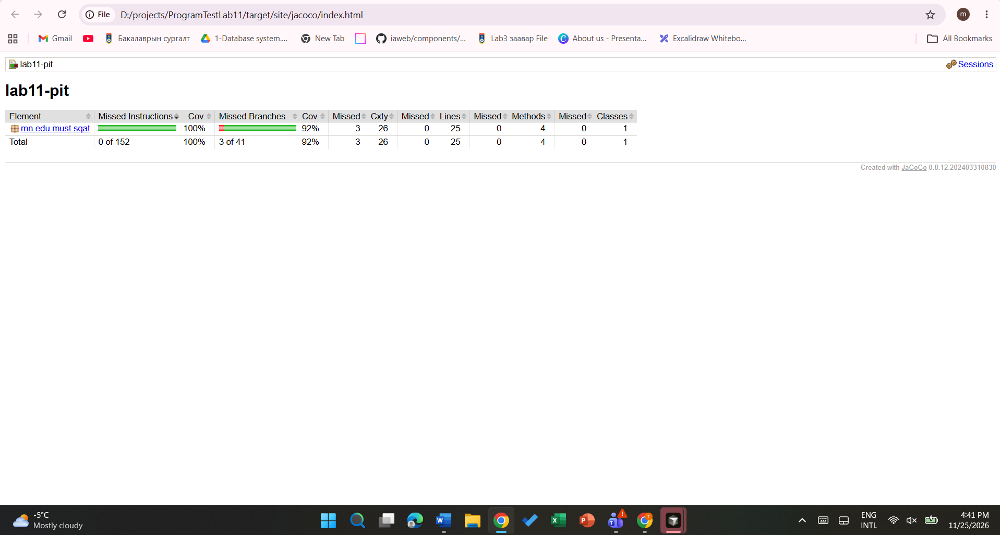

# Лаборатори 11 — Mutation testing (PIT)

**Нэр:** Түмэннасан Мөнхцэцэн  
**Оюутны код:** *B232270025*  

## Орчин

Төслийг **WSL2 (Ubuntu)** дээр ажиллуулсан (`/mnt/d/projects/ProgramTestLab11`). `pom.xml`-д `maven.compiler.release=17`, JUnit 5.10.2, JaCoCo 0.8.12, PIT (`pitest-maven` 1.16.1, `pitest-junit5-plugin` 1.2.1), мутаторын багц `STRONGER`.

```
$ java -version
openjdk version "25.0.5.1" 2026-11-17
OpenJDK Runtime Environment (build 25.0.5.1+2-1-26.04.1-Ubuntu)
OpenJDK 64-Bit Server VM (build 25.0.5.1+2-1-26.04.1-Ubuntu, mixed mode, sharing)

$ mvn --version
Apache Maven 3.9.9 (8e8579a9e76f7d015ee5ec7bfcdc97d260186937)
Java version: 25.0.5.1, vendor: Ubuntu, runtime: /usr/lib/jvm/java-25-openjdk-amd64
OS name: "linux", version: "6.6.114.1-microsoft-standard-wsl2", arch: "amd64", family: "unix"
```

---

## Хэсэг 0 — Эхлэлийн хэмжилт (Starter)

Starter тестийн багц JaCoCo-д **Line 100%** харуулдаг. Гэхдээ assertion-ууд сул тул PIT-ээр шалгахад mutation score бага байна.

| Хэмжүүр | Утга | Эх сурвалж |
| --- | --- | --- |
| Line coverage | 25/25 (100%) | `results/jacoco-start.csv` |
| Branch coverage | 38/41 (92%) | `results/jacoco-start.csv` |
| Mutations | 63 | `results/pit-start.txt` |
| Killed | 17 (27%) | `results/pit-start.txt` |
| Survived | 46 | `results/pit-start.txt` |

Тестийн нэгж `mvn verify` дээр: **Tests run: 6, Failures: 0, BUILD SUCCESS** — `results/mvn-verify-start.txt`.



**Line ба Mutation coverage-ийн зөрүү:** Line coverage нь кодын мөр гүйцэтгэгдсэнийг л хэмждэг. Тестүүд мөрүүдийг дайрч байсан ч assertion-ууд утгыг сул шалгадаг тул өөр утга буцаах, зааг алдах мутантууд амьд үлддэг. Mutation coverage нь тест өөрчлөлтийг үнэхээр илрүүлж чаддаг эсэхийг хэмждэг.

---

## Хэсэг A — Амьд мутантуудын ангилал

PIT тайлангийн 46 SURVIVED мутантыг мөр мөрөөр нь ангилсан (`target/pit-reports/mn.edu.must.sqat/ScholarshipCalculator.java.html`). Нэг мөрөнд хэд хэдэн мутант байвал PIT-ийн мутаторын нэр бүрийг тусад нь бичсэн. `Тоо` нь тухайн мөрийн амьд мутантын тоо.

| Мөр | Мутаци (PIT-ийн тайлбар) | Тоо | Ангилал | Үндэслэл ба арга хэмжээ |
| --- | --- | --- | --- | --- |
| 20 | changed conditional boundary (`score < 0`, `score > 100`) | 2 | Тест дутуу | Энэ өөрчлөлт 0 ба 100 дээрх зан төлөвийг өөрчилдөг тул тест дутуу. Арга хэмжээ: `letterGrade(0)`, `letterGrade(100)`-ийн тест нэмэх (B2). |
| 23 | changed conditional boundary; removed conditional (true, false); replaced return value with `""` | 4 | Тест дутуу | Энэ өөрчлөлт 90-ийн үр дүнг өөрчилдөг тул тест дутуу. Арга хэмжээ: `letterGrade(90)` = `"A"`, `letterGrade(89.99)` = `"B"` гэж яг шалгах (B1, B2). |
| 24 | changed conditional boundary; removed conditional (true, false); replaced return value with `""` | 4 | Тест дутуу | Энэ өөрчлөлт 80-ийн үр дүнг өөрчилдөг тул тест дутуу. Арга хэмжээ: `letterGrade(80)` = `"B"`, `letterGrade(79.99)` = `"C"` (B1, B2). |
| 25 | changed conditional boundary; removed conditional (true, false); replaced return value with `""` | 4 | Тест дутуу | Энэ өөрчлөлт 70-ийн үр дүнг өөрчилдөг тул тест дутуу. Арга хэмжээ: `letterGrade(70)` = `"C"`, `letterGrade(69.99)` = `"D"` (B1, B2). |
| 26 | changed conditional boundary; removed conditional (true, false); replaced return value with `""` | 4 | Тест дутуу | Энэ өөрчлөлт 60-ийн үр дүнг өөрчилдөг тул тест дутуу. Арга хэмжээ: `letterGrade(60)` = `"D"`, `letterGrade(59.99)` = `"F"` (B1, B2). |
| 27 | replaced return value with `""` (`return "F"`) | 1 | Тест дутуу | Энэ өөрчлөлт F үсгийн утгыг хоосон мөр болгодог тул тест дутуу; одоогийн тест `assertNotNull`-аар шалгадаг. Арга хэмжээ: `assertEquals("F", letterGrade(30))` (B1). |
| 36 | changed switch default (default-ийг эхэнд байрлуулсан) | 1 | **Equivalent** | Зан төлөв ижил тул equivalent: `default` зөвхөн ямар ч case таарахгүй үед ажилладаг, бүх case `break`-тэй тул `default`-ийн байрлал гүйцэтгэлд нөлөөлдөггүй. Тест нэмэхгүй. |
| 38 | replaced double addition with subtraction (`total += 3` → `-=`) | 1 | Тест дутуу | Энэ өөрчлөлт B үсгийн оноог хасдаг тул gpa өөр болдог боловч одоогийн тест зөвхөн муж (0–4) шалгадаг. Арга хэмжээ: gpa-ийн яг утгыг шалгах (B1). |
| 40 | replaced double addition with subtraction (`total += 1` → `-=`) | 1 | Тест дутуу | Энэ өөрчлөлт D үсгийн оноог хасдаг тул gpa өөр болдог боловч одоогийн тест зөвхөн муж шалгадаг. Арга хэмжээ: gpa-ийн яг утгыг шалгах (B1). |
| 44 | replaced double return with `0.0` (`return total / scores.length`) | 1 | Тест дутуу | Энэ өөрчлөлт gpa-ийн буцаах утгыг өөрчилдөг тул тест дутуу; одоогийн тест gpa-ийн яг утгыг шалгаагүй. Арга хэмжээ: gpa-ийн яг утгыг шалгах (B1). |
| 48 | changed conditional boundary (2); removed conditional (1) (`gpa < 0 \|\| gpa > 4 \|\| credits < 0`) | 3 | Тест дутуу | Энэ өөрчлөлт 0, 4 ба credits 0 дээрх exception-ийн зан төлөвийг өөрчилдөг тул тест дутуу; одоогийн тест зааг оролтыг шалгаагүй. Арга хэмжээ: зааг оролтын тест (B2). |
| 51 | removed conditional (`if (hasViolation)` → true, false) | 2 | Тест дутуу | Энэ өөрчлөлт сахилгын зөрчлийн үед 0 буцаах зан төлөвийг өөрчилдөг тул тест дутуу; одоогийн тест (`4.0, 20, true`) зөвхөн 0–100 мужийг шалгадаг. Арга хэмжээ: `assertEquals(0, ...)` (B1). |
| 52 | replaced int return with `0`; removed conditional (2 true, 2 false); changed conditional boundary (2) | 7 | Тест дутуу | Энэ өөрчлөлт 3.8/15 босгын үр дүнг өөрчилдөг тул тест дутуу; одоогийн тест босгын яг утгыг шалгаагүй. Арга хэмжээ: `scholarship(3.8, 15, false)` = 100, `scholarship(3.79, 15, false)` ≠ 100 (B2). |
| 53 | replaced int return with `0`; removed conditional (2 true, 2 false); changed conditional boundary (2) | 7 | Тест дутуу | Энэ өөрчлөлт 3.4/12 босгын үр дүнг өөрчилдөг тул тест дутуу. Арга хэмжээ: `scholarship(3.4, 12, false)` = 70 гэж яг шалгах (B2). |
| 54 | replaced int return with `0`; removed conditional (true, false); changed conditional boundary | 4 | Тест дутуу | Энэ өөрчлөлт 3.0 босгын үр дүнг өөрчилдөг тул тест дутуу. Арга хэмжээ: `scholarship(3.0, 0, false)` = 50 гэж яг шалгах (B2). |

**Дүгнэлт:** 46 амьд мутантын 45 нь тест дутуугаас үүдсэн. Зөвхөн мөр 36 нь equivalent гэж үндэслэгдэнэ.

---

## Хэсэг B — Тестүүдийг хүчтэй болгох

### B1 — Assertion-уудыг яг утгатай болгох

Starter-ийн `assertNotNull` ба `assertTrue(муж)` шалгалтуудыг `assertEquals`-оор солисон:

- **letterGrade:** үсгэн дүн яг таарах эсэх (95 → `"A"`, 85 → `"B"`, 75 → `"C"`, 65 → `"D"`, 30 → `"F"`).
- **gpa:** яг утга (`{95, 85}` → 3.5, `{75, 65}` → 1.5, `{40}` → 0.0).
- **scholarship:** яг утга (3.9/16 → 100, 3.5/13 → 70, 3.1/5 → 50, 2.0/1 → 0, сахилгын зөрчил → 0).

`mvn test` → **Tests run: 6, Failures: 0**. PIT: **63 mutations, Killed 45 (71%)** — `results/pit-B1.txt`.

Үлдсэн 18 амьд мутант нь заагийн (changed conditional boundary) эсвэл нөхцөлийг устгасан (removed conditional) мутант: `letterGrade`-ийн заагууд (мөр 20: 2, мөр 23–26: тус бүр 1), `scholarship`-ийн `gpa`/`credits` шалгалт (мөр 48: 3), босгын мөрүүд (мөр 52: 4, мөр 53: 4, мөр 54: 1). Эдгээрийг B2-т зааг утгын тестээр алана.

### Хэмжилтийн явц

| Хэмжилт | Generated | Killed | Mutation coverage | Файл |
| --- | --- | --- | --- | --- |
| Эхлэл (Starter) | 63 | 17 | 27% | `results/pit-start.txt` |
| B1 | 63 | 45 | 71% | `results/pit-B1.txt` |
| B2 (эцсийн) |  |  |  | `results/pit-B2.txt` |

### B2 — Зааг утгын тестүүд нэмэх

---

## Хэсэг C — Гар мутант (PIT-гүй)

### C1 — Гараар хийсэн мутант

### C2 — Өөрийн equivalent мутант

---

## Дүгнэлт

---